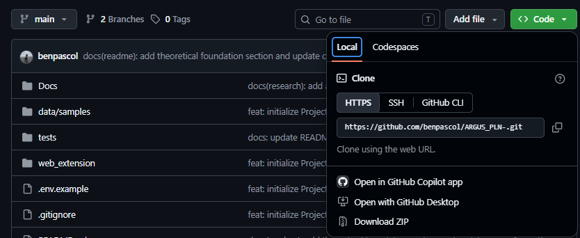
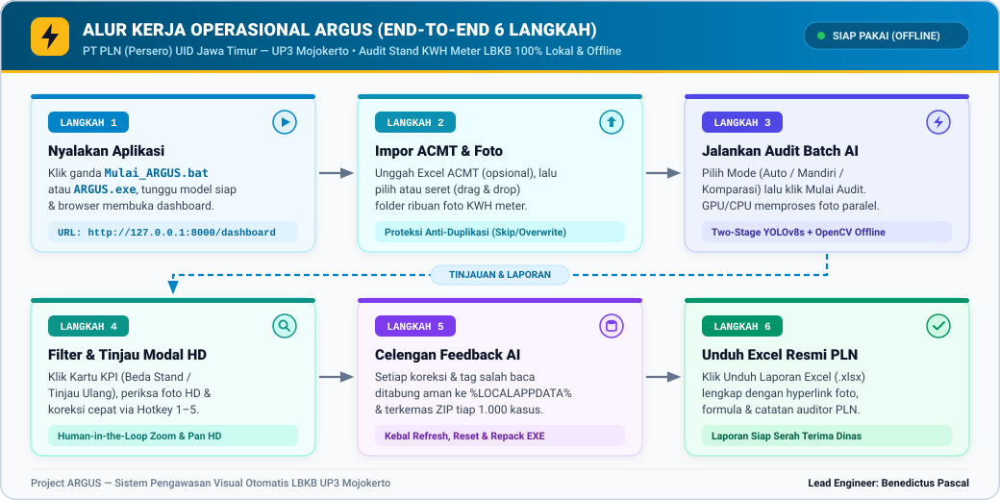
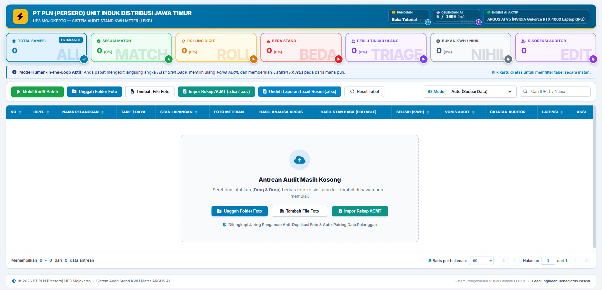
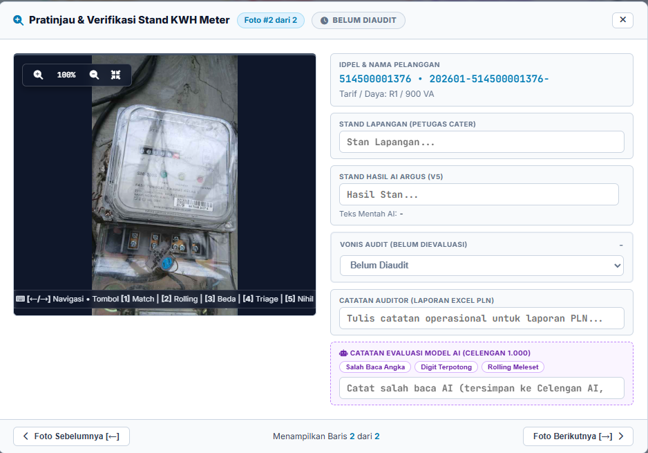
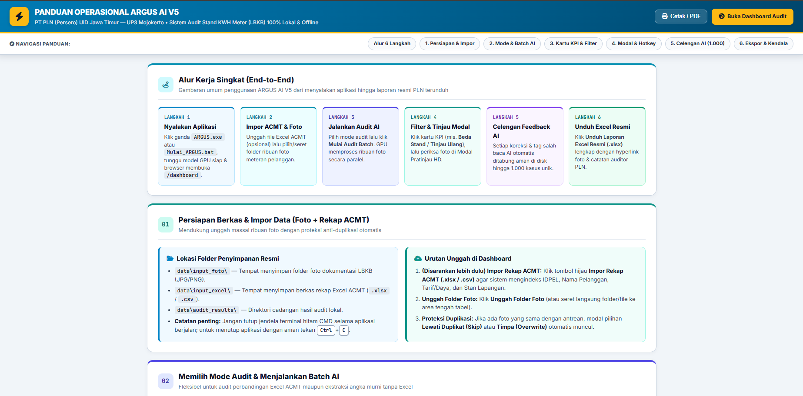
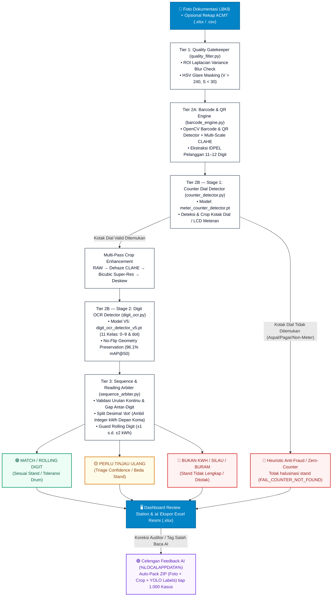

# ⚡ ARGUS v1.0.0 — Automated Recognition & Grid Utility Surveillance

**Sistem Audit Otomatis Stand KWH Meter LBKB 100% Lokal & Offline**  
**PT PLN (Persero) UID Jawa Timur — UP3 Mojokerto** | **Lead Engineer:** Benedictus Pascal

-0284C7?style=for-the-badge)


**ARGUS (*Automated Recognition & Grid Utility Surveillance*)** adalah sistem inspeksi visual digital garis depan berbasis *Two-Stage Computer Vision* untuk memvalidasi ribuan foto dokumentasi **LBKB (*Lembar Bukti Kelainan Bacaan*)** KWH Meter pelanggan setiap bulan secara lokal di lingkungan komputer PLN tanpa ketergantungan internet ataupun API cloud pihak ketiga.

> [!NOTE]
> **Kebijakan Penomoran Versi (Semantic Versioning):**
> - **Versi Rilis Aplikasi (`v1.0.0`):** Rilis produksi resmi perdana aplikasi desktop & dashboard PLN UP3 Mojokerto.
> - **Versi Bobot Model AI (`Model V5`):** Otak pengenalan angka di dalamnya menggunakan bobot `digit_ocr_detector_v5.pt` hasil 5 generasi pelatihan dataset Roboflow/YOLO serta 8 siklus penyempurnaan pra-rilis (`0.1.0` s.d. `0.8.0`). Seluruh rekam jejak *trial-and-error* tercatat lengkap di [`CHANGELOG.md`](./CHANGELOG.md).

---

## 🚀 Jalur Cepat Pengguna PLN (Siap Pakai — Tanpa Install Python)

Bagi petugas lapangan, auditor, maupun supervisor PT PLN (Persero) yang ingin langsung menjalankan aplikasi **tanpa perlu instalasi Python maupun memahami kode sumber**:

1. **Unduh Paket Portable Siap Pakai (`.zip`):**  
   Buka panel **`Releases`** di sisi kanan halaman repositori GitHub ini, lalu pilih rilis **`v1.0.0`** dan unduh berkas paket `.zip` portabel (*atau tautan distribusi internal UP3 Mojokerto*).
2. **Ekstrak Berkas ZIP:**  
   Ekstrak seluruh isi folder ke direktori kerja di komputer/laptop Windows Anda (contoh: `D:\ARGUS\`).
3. **Jalankan Dashboard Audit:**  
   Klik ganda **`Mulai_ARGUS.bat`** (atau **`ARGUS.exe`**). Jendela terminal PLN akan memuat model AI ke GPU/CPU, lalu browser otomatis membuka:  
   👉 `http://127.0.0.1:8000/dashboard`
4. **Buka Buku Panduan Operasional Kapan Saja:**  
   Klik ganda **`Buka_Panduan_ARGUS.bat`** (atau klik kartu **PANDUAN / Buka Tutorial** di kanan atas dashboard) untuk membuka panduan lengkap langkah demi langkah di:  
   👉 `http://127.0.0.1:8000/tutorial`

> [!WARNING]
> **Perbedaan Unduh Paket Siap Pakai (`Releases`) vs Kode Sumber (`<> Code → Download ZIP`):**
>
> 
>
> Tombol hijau **`<> Code` → `Download ZIP`** di halaman utama repo **HANYA mengunduh kode sumber (`.py`, `.html`, `.js`)** untuk keperluan pengembang/tim IT, dan **TIDAK berisi `ARGUS.exe`**.  
> Untuk operasional langsung oleh petugas PLN, selalu unduh paket portabel dari menu **`Releases`** (di kolom kanan GitHub).

---

## 🗺️ Alur Kerja Operasional (End-to-End 6 Langkah)

Berikut ringkasan alur penggunaan harian **ARGUS v1.0.0** dari menyalakan aplikasi hingga menghasilkan laporan Excel resmi PLN:



---

## 🖥️ Galeri Antarmuka & Fitur Utama

### 1. Dashboard Mandiri Korporat & 7 Kartu Filter KPI
Antarmuka utama bergaya korporat PT PLN (Persero) yang teroptimasi untuk memproses ribuan foto sekaligus tanpa membebani memori browser (*Virtual Slicing Pagination* & `URL.createObjectURL`).



- **3 Kartu Header Glass-Blue Interaktif:** Akses instan ke halaman `/tutorial`, monitor tabungan **Celengan Feedback AI**, serta status akselerasi perangkat keras (*GPU NVIDIA RTX* / *CPU Fallback*).
- **7 Kartu Filter KPI Instan:** *Total Sampel*, *Sesuai Match*, *Rolling Digit*, *Beda Stand*, *Perlu Tinjau Ulang*, *Bukan KWH / Nihil*, dan *Dikoreksi Auditor*.
- **Auto-Pairing Rekap ACMT:** Mengimpor berkas rekap `.xlsx`/`.csv` ACMT (`POST /api/parse-acmt-excel`) untuk memasangkan IDPEL, Nama Pelanggan, Tarif/Daya, dan Stan Lapangan secara otomatis dengan berkas foto.
- **3 Mode Audit & Worker Pool Paralel:** Mendukung mode **Auto (Sesuai Data)**, **Mandiri (Tanpa Excel)**, dan **Komparasi**, dengan eksekusi batch paralel adaptif (4 *worker* untuk GPU CUDA, 2 *worker* untuk CPU).

### 2. Modal Pratinjau HD (Human-in-the-Loop) & Celengan AI Persisten
Dirancang untuk tinjauan cepat auditor lapangan saat memverifikasi baris *Beda Stand* atau *Perlu Tinjau Ulang*:



- **Stasiun Inspeksi Cepat:** Dilengkapi *Zoom & Pan* beresolusi penuh, navigasi papan ketik (`←` / `→` mengikuti filter & urutan sortir aktif), serta *hotkey* vonis `[1..5]`.
- **Smart Baseline Un-Edit:** Jika koreksi auditor dikembalikan sama persis dengan pembacaan awal AI dan catatan AI dikosongkan, status *Dikoreksi* otomatis dibatalkan.
- **Pemisahan Catatan PLN vs Catatan Model AI:**
  - *Catatan Auditor:* Khusus keterangan operasional yang masuk ke laporan dinas Excel PLN.
  - *Catatan Evaluasi Model AI:* Tag cepat sekali klik (*`Salah Baca Angka`*, *`Digit Terpotong`*, *`Rolling Meleset`*) untuk melatih ulang AI tanpa mengotori laporan dinas PLN.
- **Celengan Feedback AI di `%LOCALAPPDATA%`:** Setiap kasus koreksi tersimpan persisten di `%LOCALAPPDATA%\ARGUS_PLN\feedback_vault\` (aman dari *Refresh*, *Reset Tabel*, maupun pembaruan EXE). Otomatis terkemas menjadi arsip **ZIP siap latih** (*Master Excel + Manifest CSV + Foto + Crop + Pre-Label YOLO*) ketika genap **1.000 kasus unik**, lengkap dengan tombol **Buka Folder Celengan** langsung ke File Explorer.
- **Ekspor Laporan Resmi Excel PLN (`.xlsx`):** Menghasilkan buku kerja standar UP3 Mojokerto berisi 4 baris header legenda eksekutif, pewarnaan otomatis status, serta rumus aktif `=HYPERLINK(...)` menuju bukti foto terkait.

### 3. Buku Panduan Operasional Interaktif (`/tutorial`)
Tersedia halaman panduan visual lengkap secara *offline* dengan bilah navigasi penuh ujung-ke-ujung (*sticky navbar*), dukungan cetak PDF, panduan *hotkey*, serta pemecahan masalah umum.



---

## 🏗️ Arsitektur Teknis (`100% Pure Local & Offline`)

Seluruh tahapan pemrosesan citra, pembacaan angka, hingga pelaporan berjalan sepenuhnya di perangkat lokal tanpa memanggil API eksternal:



---

## 🛠️ Technology Stack (ARGUS v1.0.0)

| Lapisan Sistem | Teknologi / Pustaka Utama | Fungsi dalam Sistem |
| :--- | :--- | :--- |
| **Compute & Hardware** | PC Windows 10/11 (64-bit), NVIDIA RTX CUDA (`fallback` Multi-Core CPU) | Akselerasi inferensi lokal paralel tanpa internet |
| **Deep Learning & AI** | Python `3.11`, PyTorch (`2.6+cu124`), Ultralytics YOLOv8 (`8.4+`) | Two-Stage Counter Localizer + 11-Class Digit OCR (`Model V5`) |
| **Computer Vision** | OpenCV (`5.0+`), NumPy (`2.4+`) | Laplacian blur, HSV glare masking, CLAHE, Super-Res, Barcode/QR |
| **Training & Anotasi** | Roboflow (*strict No-Flip augmentation*), Google Colab GPU (`T4`/`A100`) | Kurasi dataset 11 kelas & pelatihan bobot `v1`–`v5` |
| **Backend & Local API** | FastAPI, Uvicorn (ASGI), Pydantic V2, Python `asyncio` | REST API lokal (`/predict*`, `/api/*`), parsing Excel & status hardware |
| **Pelaporan Dinas** | OpenPyXL (`3.1+`), modul CSV standar | Generator laporan `.xlsx` ber-hyperlink foto & formula otomatis |
| **Frontend Dashboard** | HTML5, Jinja2 Templates, Vanilla JavaScript (ES6+), Corporate CSS3 | Dashboard modular, Virtual Pagination, Modal Inspector, `/tutorial` |
| **Active Learning Vault** | `%LOCALAPPDATA%\ARGUS_PLN\feedback_vault\`, `zipfile` | Penyimpanan kasus koreksi kebal *reset/repack* + ekspor label YOLO |
| **Packaging & Otomasi** | PyInstaller (`--onedir`, `6.22+`), Windows Batch Scripts (`.bat`), Git | Kompilasi `ARGUS.exe` mandiri & peluncur instan *zero-config* |

---

## 📂 Struktur Repositori Bersih

```text
ARGUS/
├── .env.example                       # Template variabel konfigurasi lokal
├── .gitignore                         # Proteksi data rahasia PLN, model biner, & cache
├── ARGUS.ico                          # Ikon resmi aplikasi ARGUS
├── ARGUS.spec                         # Spesifikasi build PyInstaller
├── CHANGELOG.md                       # Rekam jejak rilis & trial-and-error (0.1.0 → 1.0.0)
├── PETUNJUK_PENGGUNAAN_ARGUS.txt      # Panduan operasional versi teks untuk distribusi ZIP
├── README.md                          # Dokumentasi utama proyek (berkas ini)
├── RULEBOOK.md                        # Konstitusi standar rekayasa & integritas Computer Vision
├── WHITEBOARD.md                      # Roadmap pengembangan, log ide & audit log
├── build_exe.py                       # Otomasi build paket portabel dist/ARGUS/
├── launcher.py                        # Entrypoint portabel dengan proteksi QuickEdit freeze CMD
├── pyproject.toml                     # Konfigurasi interpreter Python & Pyright
│
├── Docs/
│   ├── requirements.txt               # Daftar dependensi runtime Python
│   └── assets/                        # Aset gambar & diagram vektor SVG untuk dokumentasi
│       ├── alur_kerja_6_langkah.svg
│       ├── Dashboard_Utama.png
│       ├── Halaman_Tutorial.png
│       ├── Pratinjau_Human-in-the-loop.png
│       └── dropdown_code_untukdownload.png
│
├── data/
│   ├── input_excel/                   # Direktori default berkas rekap ACMT + BACA_SAYA.txt
│   ├── input_foto/                    # Direktori default folder foto dokumentasi + BACA_SAYA.txt
│   └── samples/                       # 10 sampel foto meteran resmi untuk smoke test instan
│
├── models/                            # [GITIGNORED] Bobot model AI (.pt): meter_counter & digit_ocr_v5
│
├── src/
│   ├── audit_excel.py                 # Engine penyusun laporan resmi Excel ber-hyperlink PLN
│   ├── excel.py                       # Helper utilitas Excel
│   ├── feedback_vault.py              # Pengelola Celengan Feedback AI di %LOCALAPPDATA%
│   ├── train_finetune.py              # Pipeline pelatihan ulang / fine-tuning model dari vault
│   ├── api/
│   │   ├── dependencies.py            # Manajemen singleton GPU pipeline, deteksi hardware & JSON sanitizer
│   │   ├── server.py                  # Aplikasi utama FastAPI, lifespan & auto-launch browser
│   │   └── routes/
│   │       ├── audit.py               # /predict & /predict-base64
│   │       ├── excel.py               # /api/parse-acmt-excel & /api/export-audit-excel
│   │       ├── feedback.py            # /api/feedback/* (status, sync, package-now, open-folder, download)
│   │       └── views.py               # /, /dashboard, /tutorial, /api/system-info, /sample-photo/*
│   └── vision_ai/
│       ├── barcode_engine.py          # Detektor Barcode/QR OpenCV + CLAHE
│       ├── counter_detector.py        # Stage 1 YOLO Counter Dial Localizer + Zero-Counter Anti-Fraud
│       ├── digit_ocr.py               # Stage 2 YOLO 11-Class Digit Reader + Multi-Candidate Consensus
│       ├── pipeline.py                # Orkestrator pipeline visi lokal end-to-end
│       ├── quality_filter.py          # Filter Blur Laplacian ROI, Glare HSV & Enhancer CLAHE
│       └── sequence_arbiter.py        # Validator urutan digit, splitter desimal & Triage 3 warna
│
├── tests/
│   ├── test_vlm.py                    # Pengujian kompatibilitas historis
│   └── archive/                       # Skrip verifikasi kasus batch & kalibrasi awal
│
└── web_extension/
    └── dashboard/                     # Antarmuka Web Mandiri V1 (Dashboard & Tutorial)
        ├── index.html                 # Shell halaman utama Dashboard Audit
        ├── tutorial.html              # Halaman Panduan Operasional Interaktif (/tutorial)
        ├── components/                # Komponen modular Jinja2 (header, kpi_cards, toolbar, table, modals, footer)
        └── static/
            ├── css/                   # pln_theme.css, dashboard.css, tutorial.css
            ├── js/                    # dashboard_app.js, audit_engine.js, feedback_vault.js, excel_export.js, upload_handler.js, session_store.js
            └── favicon.svg
```

---

## 💻 Panduan Pengembang / Tim IT PLN (Dari Source Code)

Bagian ini ditujukan bagi Tim IT atau pengembang yang ingin menjalankan server langsung dari kode sumber Python, memodifikasi kode, atau mengompilasi ulang paket portabel `.exe`:

### 1. Prasyarat & Lingkungan Virtual
Pastikan **Python 3.11 (64-bit)** dan **Git** sudah terpasang di Windows, lalu jalankan di PowerShell:

```powershell
git clone https://github.com/benpascol/ARGUS_PLN-.git
cd ARGUS_PLN-

python -m venv .venv_gpu
.\.venv_gpu\Scripts\Activate.ps1
pip install -r Docs/requirements.txt
```

*(Opsional untuk GPU NVIDIA RTX)*: Pastikan PyTorch terpasang dengan dukungan CUDA (mis. CUDA 12.4) sesuai driver GPU agar pemrosesan batch berjalan optimal:
```powershell
pip install torch torchvision --index-url https://download.pytorch.org/whl/cu124
```

### 2. Penempatan Bobot Model AI (`.pt`)
Salin berkas bobot model terlatih ke dalam folder `models/`:
- `models/meter_counter_detector.pt` *(Stage 1 Counter Localizer)*
- `models/digit_ocr_detector_v5.pt` *(atau `digit_ocr_detector.pt` — Stage 2 OCR 11-Class)*

### 3. Menjalankan Aplikasi (Mode Pengembangan)
```powershell
.\.venv_gpu\Scripts\python.exe launcher.py
```
Server akan menyala pada `http://127.0.0.1:8000` dan otomatis membuka browser ke `/dashboard`.

### 4. Referensi Endpoint REST API Lokal
| Method | Endpoint | Fungsi Utama |
| :--- | :--- | :--- |
| `GET` | `/` | Status *health-check* engine & metadata versi (`1.0.0`) |
| `GET` | `/dashboard` | Antarmuka utama Dashboard Audit Stand KWH Meter |
| `GET` | `/tutorial` | Halaman Panduan Operasional Interaktif *Offline* |
| `GET` | `/api/system-info` | Deteksi riil GPU RTX / CPU & konkurensi *worker pool* |
| `POST` | `/predict` | Inferensi AI satu citra via *Multipart Form-Data* |
| `POST` | `/predict-base64` | Inferensi AI berkecepatan tinggi via payload Base64 JSON |
| `POST` | `/api/parse-acmt-excel` | Parsing & pemetaan kolom rekap ACMT (`.xlsx`, `.xls`, `.csv`) |
| `POST` | `/api/export-audit-excel` | Pembuatan berkas Excel resmi PLN ber-hyperlink foto |
| `GET` | `/api/feedback/status` | Memeriksa jumlah tabungan Celengan AI & rilis ZIP tersedia |
| `POST` | `/api/feedback/sync` | Menyinkronkan koreksi & catatan AI ke `%LOCALAPPDATA%` |
| `POST` | `/api/feedback/package-now` | Mengemas manual tabungan Celengan AI menjadi berkas ZIP |
| `POST` | `/api/feedback/open-folder` | Membuka direktori `%LOCALAPPDATA%\ARGUS_PLN\feedback_vault` |
| `GET` | `/api/feedback/download/{fname}` | Mengunduh berkas ZIP hasil kemas paket Celengan AI |

### 5. Mengompilasi Ulang Paket Portabel `.exe`
Untuk membungkus ulang aplikasi siap sebar ke direktori `dist/ARGUS/`:
```powershell
.\.venv_gpu\Scripts\python.exe build_exe.py
```

---

## 📚 Tata Kelola Dokumentasi (*The Holy Trinity*)

Seluruh pengembangan proyek tunduk pada 3 dokumen inti + log rilis resmi:
- 📄 **[`README.md`](./README.md)** — Wajah proyek, panduan instalasi, alur kerja & arsitektur sistem.
- 📜 **[`RULEBOOK.md`](./RULEBOOK.md)** — Konstitusi hukum teknis, aturan keamanan data PLN, & integritas Computer Vision.
- 🎯 **[`WHITEBOARD.md`](./WHITEBOARD.md)** — Roadmap 5 fase, rekam jejak keputusan arsitektur & catatan isu (*audit trail*).
- 🧾 **[`CHANGELOG.md`](./CHANGELOG.md)** — Catatan rilis terstruktur dari `0.1.0` hingga rilis resmi `1.0.0`.

---

**PT PLN (Persero) Unit Induk Distribusi Jawa Timur — UP3 Mojokerto**  
*Lead Engineer: **Benedictus Pascal***
