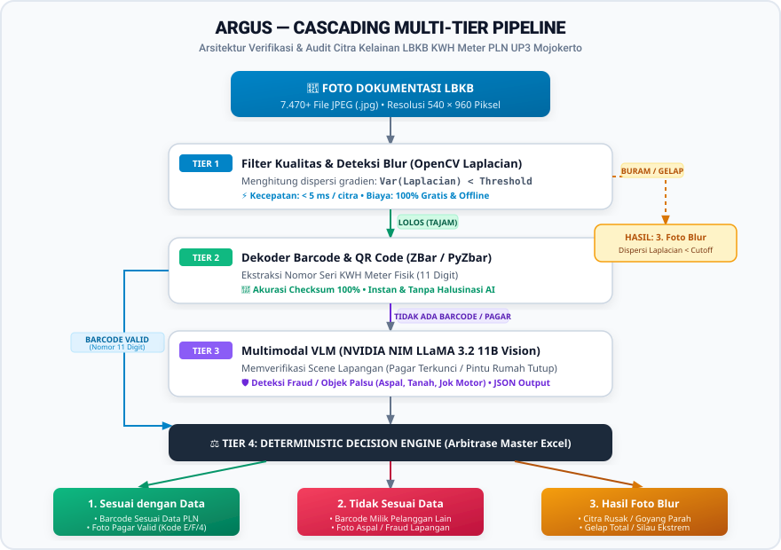
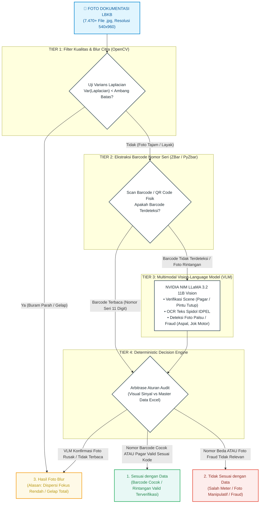

# ARGUS — Automated Recognition & Grid Utility Surveillance

Sistem cerdas klasifikasi dan audit otomatis berkas **LBKB (Lembar Bukti Kelainan Bacaan)** pelanggan KWH Meter PLN UP3 Mojokerto berbasis **Cascading Multi-Tier Computer Vision**, **Barcode Checksum Decoding**, dan **Multimodal Vision-Language Model (VLM)**.

Sistem ini berfungsi sebagai inspektur digital garis depan untuk memvalidasi $\pm 8.000$ foto dokumentasi kelainan lapangan per bulan, menyaring manipulasi/fraud petugas, mendeteksi foto buram, serta mencocokkan nomor seri fisik meteran prabayar/pascabayar terhadap master database penagihan PLN secara instan dan akuntabel.

---

## 🏗 Arsitektur Sistem & Cascading Multi-Tier Pipeline



<details>
<summary><b>🔍 Klik di sini untuk melihat Definisi Kode Mermaid (GitHub Native)</b></summary>



</details>

---

## 🎯 3 Kategori Output Klasifikasi Resmi

Sesuai standar pengawasan transaksi energi PT PLN (Persero), setiap rekaman foto akan diklasifikasikan ke dalam 3 status definitif:

1. **`Sesuai dengan Data`**:
   - Bukti foto terbukti valid: nomor barcode/nomor seri meteran identik dengan data master pelanggan di PLN.
   - ATAU bukti foto rintangan (pagar terkunci, rumah tutup, anjing galak) terverifikasi secara visual selaras dengan `KODE LBKB` (`E`, `F`, `4`) yang dilaporkan petugas.
2. **`Tidak Sesuai dengan Data`**:
   - Nomor meter fisik yang tertera di foto berbeda dengan data pelanggan (salah objek / foto meteran tetangga).
   - ATAU terindikasi manipulasi/fraud: petugas melaporkan rumah tutup/pagar terkunci namun foto yang diunggah adalah aspal jalan, tanah, dinding kosong, atau meteran menyala normal.
3. **`Hasil foto blur`**:
   - Kualitas foto rusak parah, goyang (_motion blur_), gelap gulita, atau silau ekstrem sehingga nomor meter maupun kondisi lapangan tidak dapat diidentifikasi secara sah.

---

## 📂 Struktur Repositori

```text
ARGUS/
├── .env                                       # [IGNORED] Secret API Key (NVIDIA NIM)
├── .gitignore                                 # [TRACKED] Filter file besar & credentials
├── README.md                                  # [TRACKED] Wajah Proyek & Arsitektur Pipeline
├── RULEBOOK.md                                # [TRACKED] Konstitusi Hukum & Gitflow
├── WHITEBOARD.md                              # [TRACKED] Roadmap, Ide & Audit Issue
│
├── data/                                      # Data Citra & Master Dokumen
│   ├── raw_excel/                             # [IGNORED] Master File 12 LBKB Rek 12 2025 (277MB)
│   ├── raw_images/                            # [IGNORED] Folder DOkumentasi LBKB (7.470+ File .jpg)
│   ├── samples/                               # [TRACKED] 15-20 Foto Sampel Terpilih untuk Benchmark
│   └── output/                                # [IGNORED] Hasil Ekspor Excel Klasifikasi & Log Audit
│
├── src/                                       # Core Python Cascading Engine
│   ├── quality/                               # Tier 1: OpenCV Laplacian Blur Detector
│   ├── barcode/                               # Tier 2: ZBar / PyZbar Barcode Scanner
│   ├── vision_ai/                             # Tier 3: Multimodal VLM (NVIDIA LLaMA Vision)
│   ├── decision/                              # Tier 4: Deterministic Decision Engine
│   └── pipeline.py                            # Master Batch Processor Runner
│
├── web_extension/                             # Userscript Browser untuk Portal ACMT PLN
│   └── argus_evaluator.user.js                # Refactor & renaming dari Tanpa judul.txt
│
├── tests/                                     # Script Benchmark & Evaluasi Akurasi
│   ├── benchmark_blur.py                      # Uji Coba Threshold Laplacian
│   └── benchmark_barcode.py                   # Uji Coba Hit-Rate Barcode ZBar
│
└── Docs/                                      # Dokumentasi & Aset Visual
    ├── ARGUS_Research_Validation.md           # Laporan Validasi Riset Ilmiah (MDPI, IEEE, CMC)
    ├── arsitektur_pipeline.svg                # Vektor Diagram Pipeline Sistem
    └── requirements.txt                       # Daftar Dependensi Resmi Python
```

---

## 🔬 Spesifikasi Komponen Pipeline

### 1. Deteksi Blur (OpenCV Laplacian ROI)

- **Metode:** Konvolusi kernel Laplacian $3 \times 3$ pada citra grayscale, menghitung varians respon tepi:
  $$\sigma^2 = \frac{1}{N} \sum_{x,y} (L(x,y) - \mu)^2$$
- **ROI-Focused Assessment:** Berdasarkan temuan riset, perhitungan Laplacian difokuskan pada Region of Interest (area meteran) agar tekstur kasar background (dinding/aspal) tidak memicu *false sharpness*.
- **Threshold Strategi:** Dikalibrasi secara empiris pada rentang rekomendasi literatur ($\sigma^2 \approx 80–120$ untuk citra $540 \times 960$) dengan prinsip konservatif agar tidak membuang foto valid.

### 2. Barcode & QR Scanner (ZBar Engine + CLAHE)

- **Karakteristik:** Ekstraksi pola garis Code 128 / Code 39 / QR Code pada stiker KWH Meter prabayar.
- **Pre-processing CLAHE:** Dilengkapi *Contrast Limited Adaptive Histogram Equalization* dan binarisasi Otsu untuk menembus silau pantulan mika (*glare*) dan debu lapangan.
- **Keunggulan:** Menggunakan _built-in parity checksum_. Jika nomor 11 digit berhasil terbaca (misal `86 7008 2427 6`), hasil dijamin 100% akurat secara matematis tanpa halusinasi visual.

### 3. VLM Reasoning Engine (NVIDIA NIM / Gemini)

- **Model Primer:** `meta/llama-3.2-11b-vision-instruct` (via endpoint `integrate.api.nvidia.com`).
- **Peran:** Fallback cerdas untuk $\pm 20-30\%$ citra (kasus rintangan fisik pagar gembok/rumah tutup, spidol pascabayar, atau meteran tanpa barcode).
- **Format Output:** Pure JSON Response deterministik:
  ```json
  {
    "scene_type": "meteran_listrik | pagar_terkunci | rumah_tutup | fraud_anomali",
    "extracted_meter_no": "86700824276",
    "extracted_idpel": "514500001376",
    "is_blurry": false,
    "confidence_score": 0.95
  }
  ```

---

## 📚 Landasan Teori & Validasi Riset Ilmiah

Arsitektur Cascading Multi-Tier ARGUS telah divalidasi dan terbukti secara ilmiah sejalan dengan best practice industri utilitas internasional. Laporan validasi komprehensif beserta sitasi formal dapat diakses di:
👉 [`Docs/ARGUS_Research_Validation.md`](./Docs/ARGUS_Research_Validation.md)

### Intisari Justifikasi Akademik:
1. **Efisiensi Cascading Multi-Tier (*Applied Sciences MDPI, 2023 & Barkat, 2024*):**
   Memisahkan filter citra cepat (OpenCV), ekstraktor lokal ber-checksum (ZBar), dan penalaran semantik (VLM) memangkas biaya API 70–80%, mempercepat proses batch dari >3 jam menjadi belasan menit, dan cocok untuk komputer kantor PLN tanpa GPU khusus.
2. **Keunggulan Barcode Checksum vs Model Deep Learning OCR (*VFAST, 2024*):**
   Untuk deretan angka 11 digit transaksi penagihan listrik, pembacaan berbasis *parity checksum* ZBar mengeliminasi risiko halusinasi angka (misal angka `8` terbaca `3` atau `0` terbaca `O`) yang kerap menjangkiti OCR/VLM.
3. **Penyaringan Kualitas Citra & ROI (*Computers, Materials & Continua, 2023*):**
   *Image quality assessment* no-reference berbasis Laplacian Variance adalah gerbang wajib (*gatekeeper*) sebelum data masuk ke tahap ekstraksi, dengan rekomendasi eksekusi pada ROI objek meteran.
4. **Verifikasi Kepatuhan & Deteksi Manipulasi (*IEEE ICASSP, 2024 & MDPI Sensors, 2024*):**
   VLM multimodal terbukti efektif mendeteksi citra anomali atau foto manipulasi (petugas mengunggah aspal, tanah, atau jok motor saat mengklaim kendala rintangan lapangan).

---

## 🛠 Panduan Instalasi & Setup Lingkungan Kerja

Ikuti langkah-langkah berikut untuk mengonfigurasi lingkungan kerja lokal ARGUS:

### 1. Prasyarat Sistem

- **Python:** Versi 3.10 s.d. 3.14 (64-bit).
- **Git:** Pastikan Git terpasang dan SSH key terdaftar di GitHub.

### 2. Inisialisasi Virtual Environment & Dependensi

Buka PowerShell pada direktori proyek `ARGUS/` dan jalankan:

```powershell
# 1. Buat lingkungan virtual terisolasi
python -m venv .venv

# 2. Aktifkan virtual environment (Windows PowerShell)
.\.venv\Scripts\activate

# 3. Instal seluruh dependensi resmi ARGUS
pip install -r Docs/requirements.txt
```

### 3. Konfigurasi Kredensial Environment (`.env`)

Salin template konfigurasi dan masukkan kunci akses API:

```powershell
# Salin template .env.example menjadi .env
Copy-Item .env.example .env
```

Buka berkas `.env` dan masukkan API Key:

```env
API=your_nvidia_nim_api_key_here
BLUR_THRESHOLD=30.0
CONCURRENCY_LIMIT=5
```

### 4. Ekstensi VS Code / Antigravity IDE yang Diperlukan

Pastikan ekstensi berikut terpasang di VS Code (`Ctrl + Shift + X`):

1. **Python & Pylance (Microsoft):** Pengenalan interpreter dan debugging.
   - _Aktivasi:_ Tekan `Ctrl + Shift + P` $\rightarrow$ `Python: Select Interpreter` $\rightarrow$ pilih `('ARGUS': .venv)`.
2. **Excel Viewer (GrapeCity):** Membaca tabel file Excel langsung di VS Code tanpa membuka software MS Excel.
3. **Markdown Preview Mermaid Support (Matt Bierner):** Merender grafik Mermaid interaktif di markdown.

### 5. Modul Userscript Browser (Portal ACMT PLN)

Untuk staf operasional di portal PLN (`https://portalapp.iconpln.co.id/*`):

1. Pasang ekstensi **Tampermonkey** / **Violentmonkey** di Google Chrome atau Microsoft Edge.
2. Tambahkan script baru dan salin isi berkas `web_extension/argus_evaluator.user.js`.

---

## 📊 Project Status Tracker (ARGUS)

### The Good

- **Fondasi Ilmiah & Arsitektur Terverifikasi:** Cascading Multi-Tier Pipeline resmi divalidasi oleh literatur internasional (MDPI, IEEE, CMC) dan didokumentasikan di [`Docs/ARGUS_Research_Validation.md`](./Docs/ARGUS_Research_Validation.md).
- **Dataset Lapangan Masif & Valid:** Tersedia 7.470 foto asli lapangan beresolusi $540 \times 960$ dan 8.126 data pelanggan lengkap dengan koordinat geolokasi di Excel.
- **Kunci Akses VLM Siap Pakai:** Kredensial NVIDIA NIM API Key terpasang aman di `.env` untuk inferensi visual berkecepatan tinggi.
- **Arsitektur Berjenjang Terdefinisi:** Pemisahan tugas yang jelas antara OpenCV (kecepatan), ZBar (kepastian matematis), dan VLM (penalaran semantik).

### The Bad

- **Script Web Eksisting Salah Target:** Source code userscript `Tanpa judul.txt` masih membawa logika lama (membaca angka stand LCD pascabayar), memerlukan refactoring prompt dan parser data untuk kasus LBKB token/rintangan.
- **Background Clutter Mengelabui Laplacian:** Menghitung blur pada keseluruhan citra berisiko *false negative blur* akibat tekstur dinding/aspal (dimitigasi dengan evaluasi ROI meteran).

### The Ugly

- **Tingkat Kebersihan Stiker Barcode & Silau Lapangan:** Sebagian meteran tertutup debu atau terpapar silau mika pelindung (dimitigasi dengan preprocessing CLAHE + binarisasi adaptif sebelum ZBar).
- **Resiko Manipulasi Lapangan (Fraud):** Petugas lapangan kerap mengunggah foto tidak relevan untuk mengejar target laporan, menuntut VLM memiliki *prompt guardrails* yang ketat terhadap deteksi objek aspal/lantai/jok motor.
