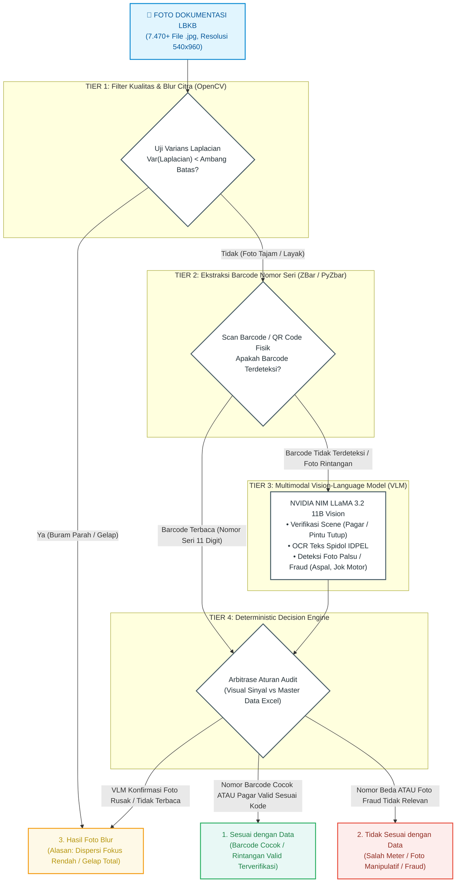

# ARGUS — Automated Recognition & Grid Utility Surveillance

Sistem cerdas klasifikasi dan audit otomatis berkas **LBKB (Lembar Bukti Kelainan Bacaan)** pelanggan KWH Meter PLN UP3 Mojokerto berbasis **Cascading Multi-Tier Computer Vision**, **Barcode Checksum Decoding**, dan **Multimodal Vision-Language Model (VLM)**.

Sistem ini berfungsi sebagai inspektur digital garis depan untuk memvalidasi $\pm 8.000$ foto dokumentasi kelainan lapangan per bulan, menyaring manipulasi/fraud petugas, mendeteksi foto buram, serta mencocokkan nomor seri fisik meteran prabayar/pascabayar terhadap master database penagihan PLN secara instan dan akuntabel.

---

## 🏗 Arsitektur Sistem & Cascading Multi-Tier Pipeline


<details>
<summary><b>🔍 Klik di sini untuk melihat Definisi Kode Mermaid (GitHub Native)</b></summary>



</details>

---

## 🎯 3 Kategori Output Klasifikasi Resmi

Sesuai standar pengawasan transaksi energi PT PLN (Persero), setiap rekaman foto akan diklasifikasikan ke dalam 3 status definitif:

1. **`Sesuai dengan Data`**:
   - Bukti foto terbukti valid: nomor barcode/nomor seri meteran identik dengan data master pelanggan di PLN.
   - ATAU bukti foto rintangan (pagar terkunci, rumah tutup, anjing galak) terverifikasi secara visual selaras dengan `KODE LBKB` (`E`, `F`, `4`) yang dilaporkan petugas.
2. **`Tidak Sesuai dengan Data`**:
   - Nomor meter fisik yang tertera di foto berbeda dengan data pelanggan (salah objek / foto meteran tetangga).
   - ATAU terindikasi manipulasi/fraud: petugas melaporkan rumah tutup/pagar terkunci namun foto yang diunggah adalah aspal jalan, tanah, dinding kosong, atau meteran menyala normal.
3. **`Hasil foto blur`**:
   - Kualitas foto rusak parah, goyang (*motion blur*), gelap gulita, atau silau ekstrem sehingga nomor meter maupun kondisi lapangan tidak dapat diidentifikasi secara sah.

---

## 📂 Struktur Repositori

```text
ARGUS/
├── .env                                       # [IGNORED] Secret API Key (NVIDIA NIM)
├── .gitignore                                 # [TRACKED] Filter file besar & credentials
├── README.md                                  # [TRACKED] Wajah Proyek & Arsitektur Pipeline
├── RULEBOOK.md                                # [TRACKED] Konstitusi Hukum & Gitflow
├── WHITEBOARD.md                              # [TRACKED] Roadmap, Ide & Audit Issue
│
├── data/                                      # Data Citra & Master Dokumen
│   ├── raw_excel/                             # [IGNORED] Master File 12 LBKB Rek 12 2025 (277MB)
│   ├── raw_images/                            # [IGNORED] Folder DOkumentasi LBKB (7.470+ File .jpg)
│   ├── samples/                               # [TRACKED] 15-20 Foto Sampel Terpilih untuk Benchmark
│   └── output/                                # [IGNORED] Hasil Ekspor Excel Klasifikasi & Log Audit
│
├── src/                                       # Core Python Cascading Engine
│   ├── quality/                               # Tier 1: OpenCV Laplacian Blur Detector
│   ├── barcode/                               # Tier 2: ZBar / PyZbar Barcode Scanner
│   ├── vision_ai/                             # Tier 3: Multimodal VLM (NVIDIA LLaMA Vision)
│   ├── decision/                              # Tier 4: Deterministic Decision Engine
│   └── pipeline.py                            # Master Batch Processor Runner
│
├── web_extension/                             # Userscript Browser untuk Portal ACMT PLN
│   └── argus_evaluator.user.js                # Refactor & renaming dari Tanpa judul.txt
│
├── tests/                                     # Script Benchmark & Evaluasi Akurasi
│   ├── benchmark_blur.py                      # Uji Coba Threshold Laplacian
│   └── benchmark_barcode.py                   # Uji Coba Hit-Rate Barcode ZBar
│
└── Docs/                                      # Dokumentasi & Aset Visual
    └── arsitektur_pipeline.svg                # Vektor Diagram Pipeline Sistem
```

---

## 🔬 Spesifikasi Komponen Pipeline

### 1. Deteksi Blur (OpenCV Laplacian)
* **Metode:** Konvolusi kernel Laplacian $3 \times 3$ pada citra grayscale, menghitung varians respon tepi:
  $$\sigma^2 = \frac{1}{N} \sum_{x,y} (L(x,y) - \mu)^2$$
* **Threshold Strategi:** Konservatif ($\sigma^2 < 30.0$). Hanya membuang foto yang benar-benar tidak terselamatkan agar tidak terjadi *False Rejection* pada foto meteran yang sedikit temaram.

### 2. Barcode & QR Scanner (ZBar Engine)
* **Karakteristik:** Ekstraksi pola garis Code 128 / Code 39 / QR Code pada stiker KWH Meter prabayar.
* **Keunggulan:** Menggunakan *built-in parity checksum*. Jika nomor 11 digit berhasil terbaca (misal `86 7008 2427 6`), hasil dijamin 100% akurat secara matematis tanpa halusinasi visual.

### 3. VLM Reasoning Engine (NVIDIA NIM / Gemini)
* **Model Primer:** `meta/llama-3.2-11b-vision-instruct` (via endpoint `integrate.api.nvidia.com`).
* **Format Output:** Pure JSON Response:
  ```json
  {
    "scene_type": "meteran_listrik | pagar_terkunci | rumah_tutup | fraud_anomali",
    "extracted_meter_no": "86700824276",
    "extracted_idpel": "514500001376",
    "is_blurry": false,
    "confidence_score": 0.95
  }
  ```

---

## 📊 Project Status Tracker (ARGUS)

### The Good
- **Dataset Lapangan Masif & Valid:** Tersedia 7.470 foto asli lapangan beresolusi $540 \times 960$ dan 8.126 data pelanggan lengkap dengan koordinat geolokasi di Excel.
- **Kunci Akses VLM Siap Pakai:** Kredensial NVIDIA NIM API Key terpasang aman di `.env` untuk inferensi visual berkecepatan tinggi.
- **Arsitektur Berjenjang Terdefinisi:** Pemisahan tugas yang jelas antara OpenCV (kecepatan), ZBar (kepastian matematis), dan VLM (penalaran semantik).

### The Bad
- **Script Web Eksisting Salah Target:** Source code userscript `Tanpa judul.txt` masih membawa logika lama (membaca angka stand LCD pascabayar), memerlukan refactoring prompt dan parser data untuk kasus LBKB token/rintangan.
- **Tingkat Kebersihan Stiker Barcode Lapangan:** Sebagian meteran di lapangan tertutup debu atau terkena pantulan mika pelindung, sehingga butuh algoritma *adaptive thresholding* sebelum masuk ke ZBar.

### The Ugly
- **Resiko Manipulasi Lapangan (Fraud):** Petugas lapangan kerap mengunggah foto tidak relevan untuk mengejar target laporan, menuntut VLM memiliki *prompt guardrails* yang ketat terhadap deteksi objek aspal/lantai/jok motor.
